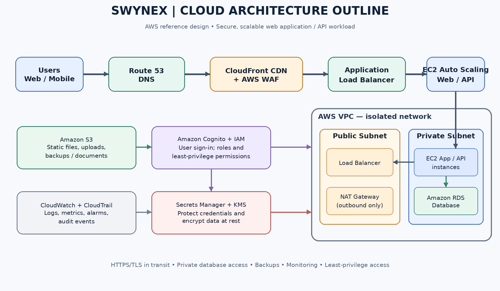

# SWYNEX Cloud Architecture Outline

**Task 1 – Cloud Computing Internship**  
**Workload:** Simple web application / REST API  
**Cloud platform:** Amazon Web Services (AWS)  
**Prepared for:** SWYNEX Technologies  
**Prepared by:** Mohamed Aasik  
**Date:** 14 November 2026

## 1. Objective
This document presents a conceptual cloud architecture for a small web application or API. It explains the compute, storage, networking, and identity components, as requested in Task 1.

## 2. Architecture overview
The design uses a Virtual Private Cloud (VPC) with public and private subnets. Users access the application over HTTPS. DNS directs traffic to a content delivery and security layer, which forwards valid requests through a load balancer to application servers. The application accesses the database privately and stores static files or uploads in object storage.

## 3. Core cloud components

### A. Compute
- **Amazon EC2:** Runs the web application or API.
- **Auto Scaling Group:** Adds or removes EC2 instances based on demand and health checks.
- **Application Load Balancer (ALB):** Distributes incoming application requests across healthy instances.
- **Conceptual alternative:** AWS App Runner or AWS Elastic Beanstalk could be used to simplify application deployment.

### B. Storage
- **Amazon S3:** Stores static website assets, user-uploaded files, and generated documents.
- **Amazon RDS:** Stores structured application data, such as user profiles and transaction records.
- **Backups:** Enable automated database backups and S3 versioning/lifecycle rules where appropriate.
- **Encryption:** Encrypt stored data using AWS Key Management Service (KMS).

### C. Networking
- **Amazon VPC:** Provides an isolated network for the application.
- **Public subnets:** Contain the internet-facing load balancer and NAT Gateway.
- **Private subnets:** Contain application servers and the database. The database is not directly reachable from the public internet.
- **Amazon Route 53:** Provides DNS routing for the application domain.
- **Amazon CloudFront:** Caches static content closer to users and reduces load on the origin.
- **AWS WAF:** Helps filter common unwanted or malicious web requests.
- **HTTPS/TLS:** Encrypts data while it travels between users and the application.

### D. Identity and access management
- **Amazon Cognito:** Provides user sign-up/sign-in and issues tokens for authenticated application access.
- **AWS IAM:** Controls what AWS services and administrators can access.
- **IAM roles:** Give EC2 instances only the permissions they need, such as reading selected S3 objects.
- **Least privilege:** Avoid broad permissions and use multi-factor authentication (MFA) for privileged accounts.

## 4. Request and data flow
1. A user opens the application using its domain name.
2. Route 53 resolves the domain to the CloudFront distribution.
3. CloudFront serves cached static files where possible. AWS WAF evaluates incoming web requests.
4. Dynamic requests are forwarded to the Application Load Balancer.
5. The load balancer sends requests to a healthy EC2 application instance in a private subnet.
6. The application verifies the user's identity/token and checks permissions.
7. The application reads or writes structured data in Amazon RDS and stores or retrieves files from Amazon S3.
8. CloudWatch collects logs and metrics; CloudTrail records account/API activity for auditing.

## 5. Security and reliability considerations
- Keep application instances and the database in private subnets where possible.
- Allow inbound application traffic only through the load balancer.
- Restrict database access to the application security group.
- Use HTTPS/TLS and encrypt data at rest.
- Store secrets in AWS Secrets Manager; do not hard-code passwords or API keys.
- Use IAM roles and least-privilege policies.
- Enable database backups, health checks, monitoring, and alerts.
- Use multiple Availability Zones for production workloads where budget and requirements allow.

## 6. Conceptual service mapping

| Requirement | AWS service | Purpose |
|---|---|---|
| Compute | EC2 + Auto Scaling | Runs and scales the application |
| Traffic distribution | Application Load Balancer | Sends requests to healthy app instances |
| Object storage | Amazon S3 | Stores static assets and uploaded files |
| Database storage | Amazon RDS | Stores structured application data |
| Networking | VPC, subnets, Route 53, CloudFront | Network isolation, DNS, and content delivery |
| Identity | Cognito and IAM | User authentication and cloud permissions |
| Security | WAF, KMS, Secrets Manager | Request filtering, encryption, and secret storage |
| Monitoring | CloudWatch and CloudTrail | Logs, metrics, alerts, and audit trail |

## 7. Assumptions and scope
- This is a conceptual learning design, not a deployed production environment.
- The workload is a small web application or API with a modest number of users.
- AWS services are examples; equivalent services from Azure, Google Cloud, or another provider can be substituted.
- Actual service sizing, availability targets, compliance controls, and monthly cost should be selected after workload requirements are known.

## 8. Conclusion
This architecture separates compute, storage, networking, and identity responsibilities. It provides a clear path for users to reach a web/API workload while keeping application and database resources protected inside a private network. It can be expanded as traffic and project requirements grow.

---
**Internship task:** SWYNEX Technologies – Task 1: Cloud Architecture Outline
